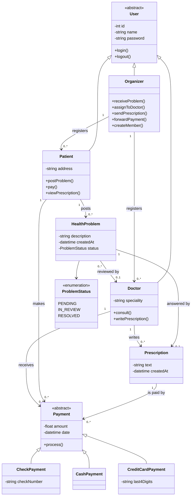
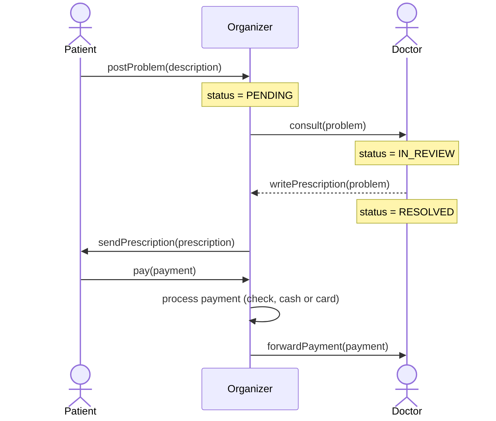
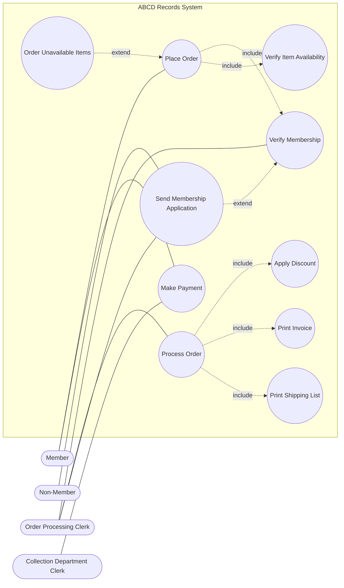
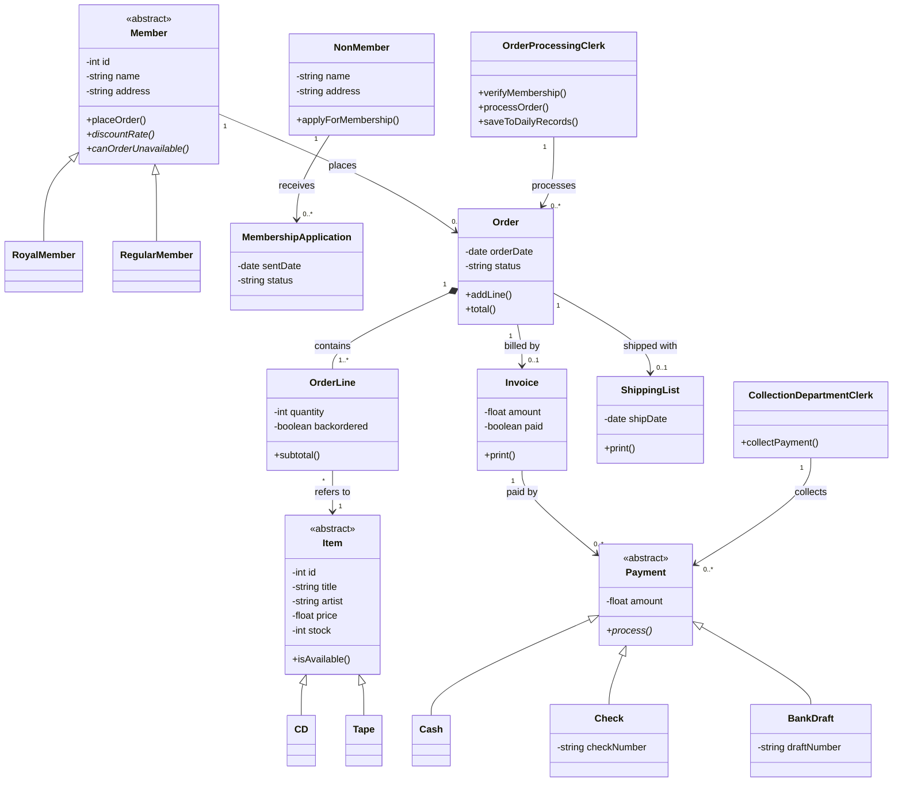

# UML exercises: diagrams

Diagrams are written in Mermaid. GitHub draws them automatically when you open this file.

## Exo 1: Hospital Management System

### Class diagram (Task 1, 2 and 3)

### Sequence diagram (Task 2: submit a problem, receive a prescription, pay)

## Exo 2: ABCD Records

### Use case diagram (Level 1 and 2)

### Class diagram (Level 1 and 2)

